<div align="center">

# 🎫 AI-Powered Ticket Routing & SLA Breach Prediction System

### Intelligent IT Service Management · AI-Assisted Ticket Routing · SLA Risk Monitoring

<p>
  <a href="https://ai-powered-ticket-routing-system-1.onrender.com/">
    
  </a>
  <a href="https://github.com/Ganeshbasani/AI-Powered-Ticket-Routing-System">
    
  </a>
</p>


<p>
  
  
  
  
  
</p>

<p>
  
  
  
  
</p>

**An AI-assisted IT service management platform that simplifies ticket operations, recommends support teams, monitors SLA deadlines, and provides transparent risk assessments.**

</div>

---

## 🔑 Live Demo Access

Explore the deployed application using the dedicated demonstration account.

<table>
  <tr><th align="left">Demo detail</th><th align="left">Access</th></tr>
  <tr><td><strong>Application</strong></td><td><a href="https://ai-powered-ticket-routing-system-1.onrender.com/">Open Live Application</a></td></tr>
  <tr><td><strong>Demo email</strong></td><td><code>demo.admin@ticketroute.local</code></td></tr>
  <tr><td><strong>Demo password</strong></td><td><code>RouteDemo!2026</code></td></tr>
  <tr><td><strong>Access role</strong></td><td>Administrator</td></tr>
</table>

> **Demo account:** Use this account only for exploring the public demonstration. Do not enter sensitive or real organizational information.

---

## 📸 Application at a Glance

The four primary screens below give recruiters and reviewers an immediate overview of the application. Select an image to view it at full size.

<table>
  <tr>
    <td width="50%" align="center"><strong>📊 Admin Dashboard</strong><br/><a href="screenshots/dashboard.png">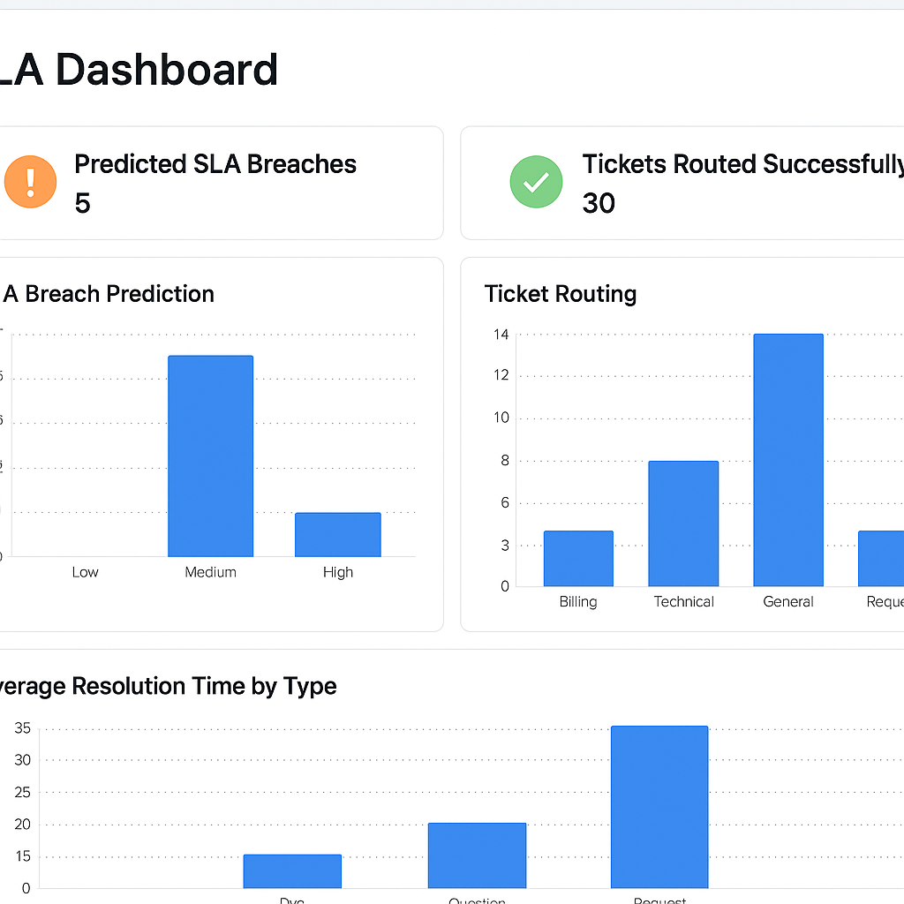</a></td>
    <td width="50%" align="center"><strong>🎫 Ticket Management</strong><br/><a href="screenshots/tickets.png">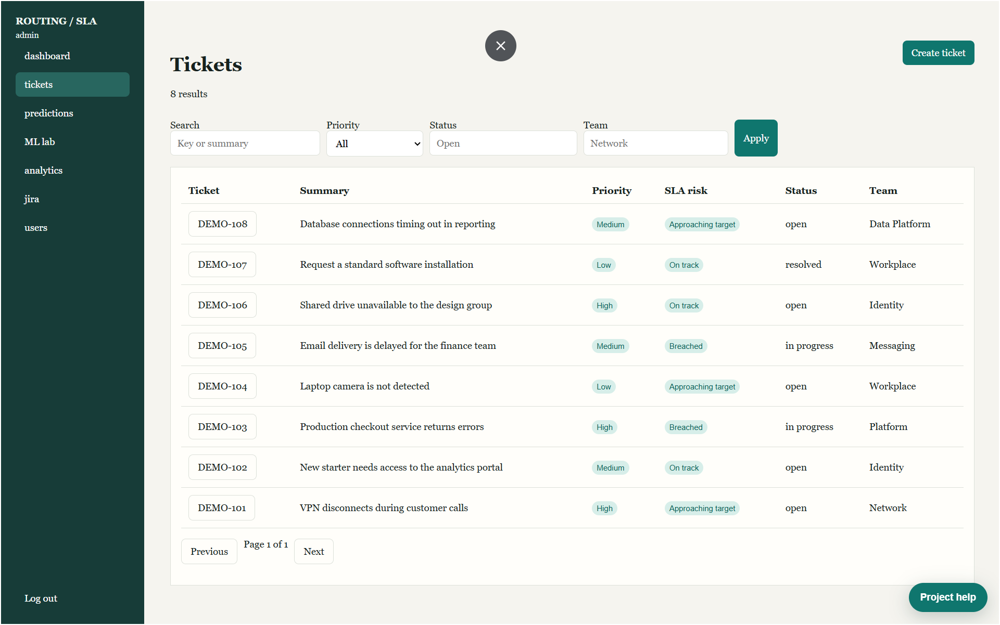</a></td>
  </tr>
  <tr>
    <td width="50%" align="center"><strong>🔮 SLA Predictions</strong><br/><a href="screenshots/prediction.png">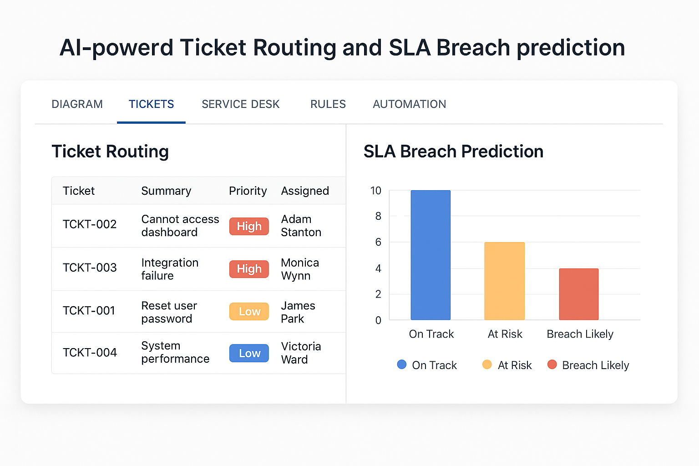</a></td>
    <td width="50%" align="center"><strong>📈 Analytics</strong><br/><a href="screenshots/Analytics.png">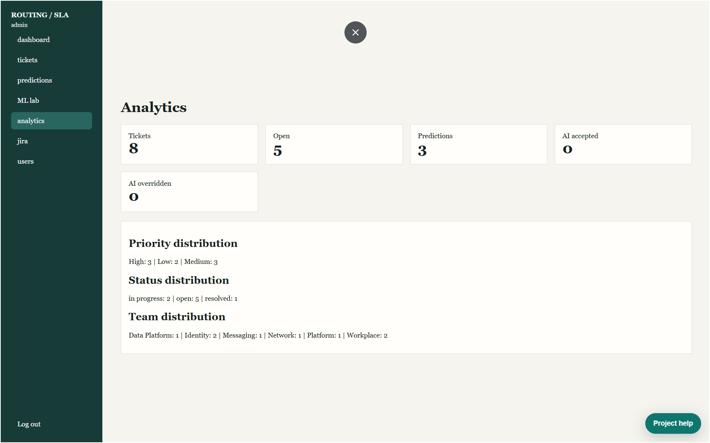</a></td>
  </tr>
</table>

---

## 📌 Table of Contents

- [Overview](#-overview)
- [The Problem](#-the-problem)
- [Key Features](#-key-features)
- [Application Showcase](#-application-showcase)
- [How the System Works](#-how-the-system-works)
- [System Architecture](#-system-architecture)
- [AI and Machine Learning](#-ai-and-machine-learning)
- [SLA Monitoring and Risk Assessment](#-sla-monitoring-and-risk-assessment)
- [Technology Stack](#-technology-stack)
- [Authentication and Access Control](#-authentication-and-access-control)
- [REST API](#-rest-api)
- [Local Installation](#-local-installation)
- [Docker Setup](#-docker-setup)
- [Testing and Verification](#-testing-and-verification)
- [Project Structure](#-project-structure)
- [Security and Reliability](#-security-and-reliability)
- [Current Limitations](#-current-limitations)
- [Future Roadmap](#-future-roadmap)
- [Documentation](#-documentation)
- [About the Developer](#-about-the-developer)
- [License](#-license)

---

## 🚀 Overview

**AI-Powered Ticket Routing & SLA Breach Prediction System** is a full-stack IT support management application designed to improve how organizations create, organize, prioritize, assign, and monitor support tickets.

In traditional IT support environments, teams often spend considerable time manually reviewing incoming tickets, identifying the responsible department, assigning priorities, and tracking resolution deadlines.

This project brings these operations into one centralized platform.

It combines:

- A ticket management interface.
- Python and Flask REST APIs.
- Machine-learning-based experimental ticket analysis.
- Intelligent support-team recommendations.
- Configurable SLA policies.
- Timestamp-based SLA monitoring.
- Risk indicators and administrative analytics.
- Role-based authentication.
- An optional local AI-powered project assistant.

The application separates **experimental ML suggestions** from **actual ticket assignments** and distinguishes learned model forecasts from deterministic SLA policy assessments.

### 🎯 Project Objective

To demonstrate how backend engineering, machine learning, predictive analytics, and workflow automation can work together to improve IT support operations.

## ❗ The Problem

Consider an organization receiving hundreds of support tickets every day.

Examples include:

- Employees unable to access company applications.
- Payment processing failures.
- Network connectivity issues.
- Software bugs.
- Account and permission requests.
- Infrastructure outages.

Without a centralized workflow, support teams may encounter:

| Challenge | Impact |
|---|---|
| Manual ticket classification | Slower ticket processing |
| Incorrect team assignment | Delayed resolution |
| Poor priority management | Critical issues may receive insufficient attention |
| Manual SLA tracking | Deadlines can be missed |
| Limited operational visibility | Difficult workload monitoring |
| Inconsistent reporting | Reduced decision-making visibility |

This project addresses these challenges through centralized ticket management, AI-assisted recommendations, and automated SLA monitoring.

---

## ✨ Key Features

### 1. 🎫 Intelligent Ticket Management

Manage support tickets through a centralized application.

- Create new support tickets.
- View and search existing tickets.
- Update ticket information.
- Track ticket status.
- Store ticket assignments.
- Maintain ticket history and associated assessments.

### 2. 🧠 AI-Assisted Ticket Analysis

The application integrates experimental text-based machine learning candidates to analyze ticket descriptions.

- Process ticket summaries and descriptions.
- Generate support-team recommendations.
- Produce experimental SLA-related model outputs.
- Display model provenance and confidence information.
- Identify predictions requiring human review.
- Preserve the distinction between recommendations and confirmed decisions.

**Important:** Current model candidates use synthetic development data. Their outputs are experimental and are not validated real-world accuracy estimates.

### 3. 🔀 Intelligent Support-Team Recommendations

The system can generate team recommendations from ticket text.

Example:

| Ticket description | Possible team recommendation |
|---|---|
| Unable to access company account | Identity |
| Network connectivity failure | Network |
| Workplace software issue | Workplace |

Recommendations are stored separately from the actual assigned team.

A human administrator or authorized user must confirm an assignment. The system does not silently assign tickets based on uncertain model predictions.

### 4. ⏱️ Dynamic SLA Monitoring

Monitor ticket deadlines using elapsed time calculated from timestamps.

- Calculate ticket age dynamically.
- Compare ticket age against configured SLA targets.
- Identify tickets approaching their deadlines.
- Detect breached deadlines.
- Display SLA status indicators.
- Generate dashboard alerts.
- Refresh operational dashboard information periodically.

### 5. 📊 Administrative Analytics

The dashboard provides operational visibility into support activities.

- Total ticket counts.
- Open and closed ticket information.
- Ticket distribution.
- SLA risk information.
- Breached and approaching-target alerts.
- Assessment and monitoring information.

### 6. 🔐 Role-Based Authentication

The application supports controlled access through different user roles.

- Administrator.
- Analyst.
- Support Agent.

Protected API endpoints enforce authentication and authorization.

### 7. 🤖 Local Project Help Assistant

An optional documentation-based assistant helps users understand the application.

- Answers questions about project workflows.
- Searches bundled FAQs and documentation.
- Can use a locally running Ollama model.
- Falls back to documentation-based answers when Ollama is unavailable.
- Keeps the optional LLM integration restricted to a local loopback service.

### 8. 🧪 Machine Learning Lab

The application includes an experimental ML environment for inspecting candidate models.

- View model availability.
- Compare experimental text-model outputs.
- Inspect development metrics.
- Review model provenance.
- Understand dataset limitations.
- Explore model-training requirements.

### 9. 🔗 JIRA Workflow Demonstration

The application includes a mock JIRA import workflow for demonstrating ticket import and integration-style operations.

A live production JIRA provider is not currently configured.

---

## 📸 Application Showcase

The following screenshots are taken from the repository's `screenshots/` directory.

### 🔐 1. Login and Authentication

The login interface provides the entry point to the ticket management platform.

<p align="center">
  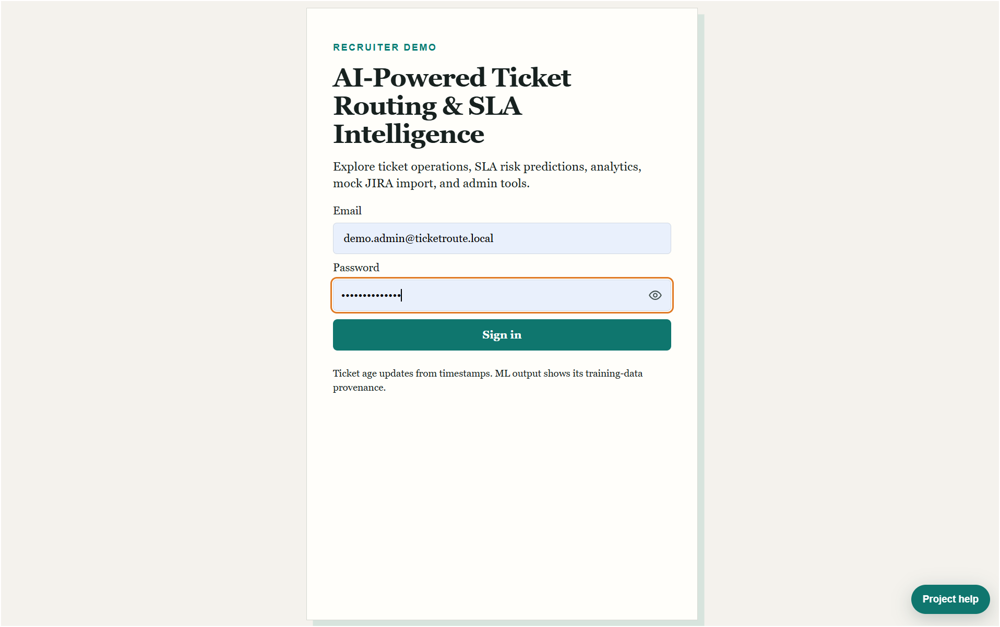
</p>

### 📊 2. Administrative Dashboard

The dashboard provides a centralized view of ticket operations, analytics, and SLA monitoring.

<p align="center">
  
</p>

<p align="center">
  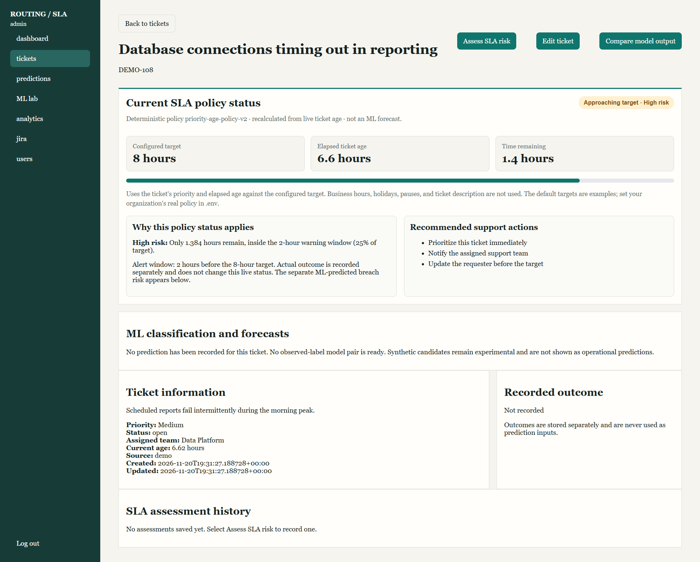
</p>

### 🎫 3. Ticket Management

Manage support requests and monitor their operational status.

<p align="center">
  
</p>

### 🔮 4. SLA Prediction and Assessment

Explore ticket risk assessments, SLA status, and associated prediction information.

<p align="center">
  
</p>

<p align="center">
  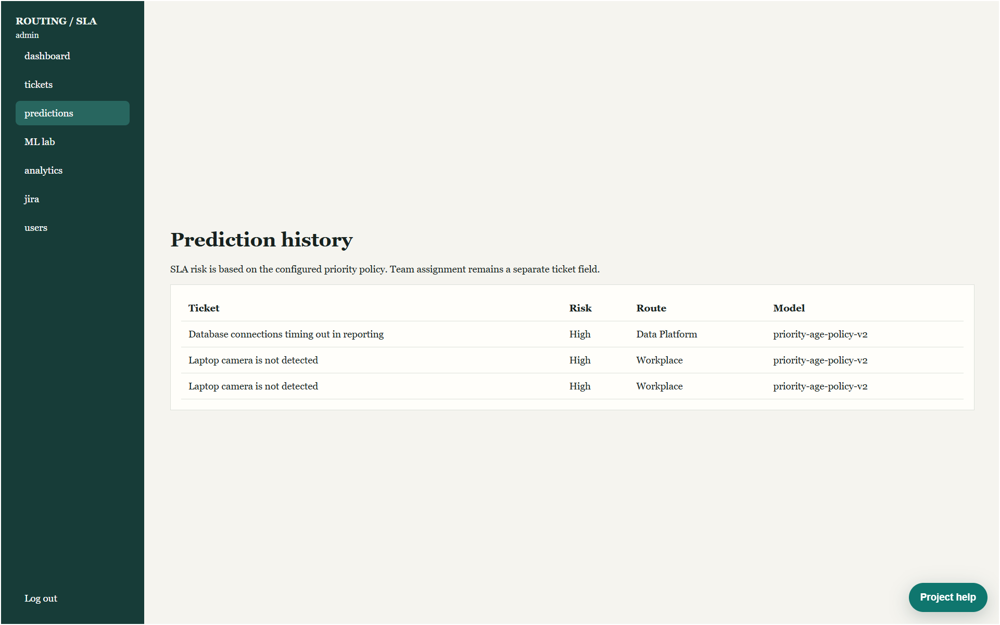
</p>

### 📈 5. Analytics

View operational analytics and ticket-related statistics.

<p align="center">
  
</p>

### 🧪 6. Machine Learning Lab

Explore the experimental machine learning environment and candidate-model information.

<p align="center">
  
</p>

### 🔗 7. JIRA Integration Workflow

Explore the mock JIRA ticket-import workflow.

<p align="center">
  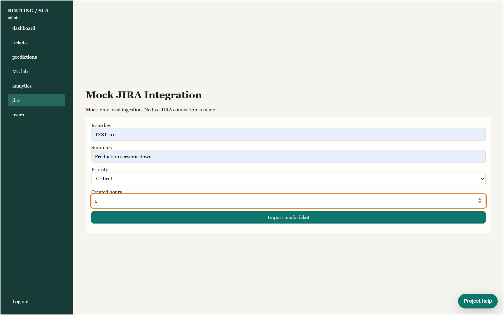
</p>

### 🤖 8. Project Help Assistant

Interact with the project's documentation assistant.

<p align="center">
  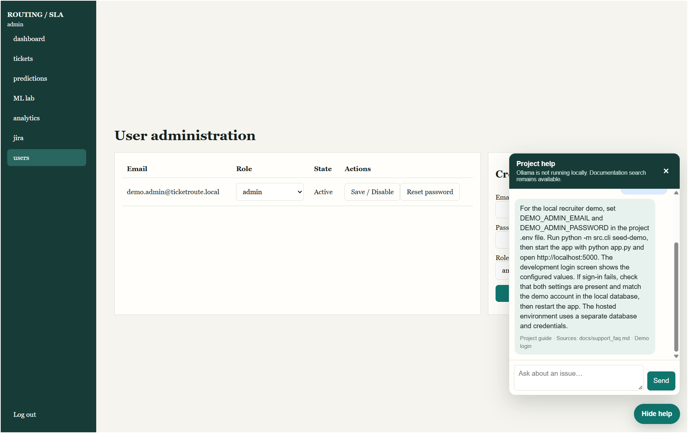
</p>

---

## ⚙️ How the System Works

The application follows a structured ticket-processing workflow.

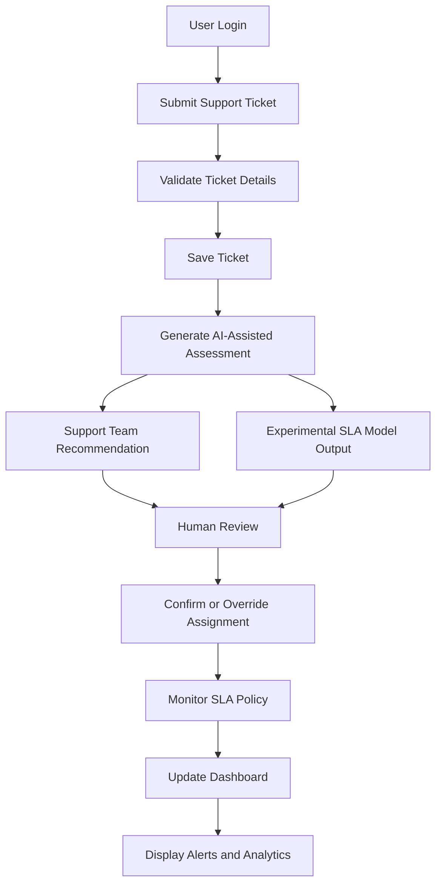

### Workflow Explanation

| Stage | Operation |
|---|---|
| 1 | User authenticates |
| 2 | User creates a support ticket |
| 3 | Backend validates the request |
| 4 | Ticket is persisted |
| 5 | Available text candidates generate separate assessments |
| 6 | Recommendations and provenance are saved |
| 7 | Authorized users review and confirm assignments |
| 8 | SLA policy evaluates ticket age and priority |
| 9 | Dashboard updates alerts and analytics |

The system remains functional when optional ML models are unavailable. In that situation, the ticket can still be created, while its assessment indicates that a model result is unavailable.

---

## 🏗️ System Architecture

The project uses a modular architecture separating the user interface, backend API, machine-learning services, persistence layer, and operational monitoring.

<p align="center">
  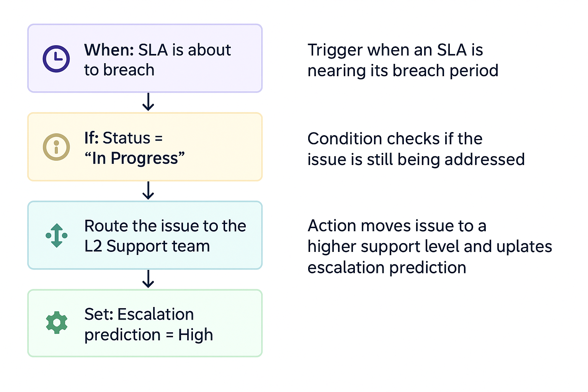
</p>

### High-Level Architecture

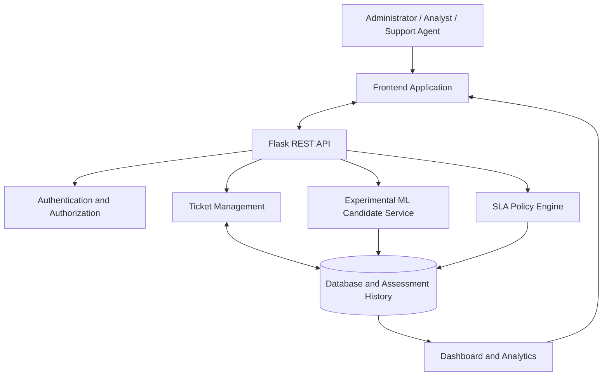

### Architectural Components

| Component | Responsibility |
|---|---|
| Frontend | User interaction and dashboard |
| Flask API | Request processing and application logic |
| Authentication | Login and token verification |
| Authorization | Role-based access enforcement |
| Ticket Service | Ticket creation and management |
| ML Candidate Service | Experimental text analysis |
| SLA Policy Engine | Deadline and risk calculations |
| Persistence Layer | Ticket and assessment storage |
| Analytics | Aggregated operational information |

---

## 🧠 AI and Machine Learning

Machine learning is integrated as an experimental recommendation layer.

The application separates model-generated suggestions from operational decisions.

### Experimental ML Capabilities

- Text preparation and processing.
- TF-IDF-based text representation.
- Classification candidates.
- Support-team recommendation.
- Experimental SLA-related model outputs.
- Model provenance and confidence tracking.
- Human-review indicators.

### Model Transparency

The application distinguishes between:

| Output | Meaning |
|---|---|
| Team recommendation | Experimental suggested support team |
| Confidence score | Model-reported candidate score |
| Review status | Whether human verification is required |
| Policy SLA status | Current status from configured SLA rules |
| Candidate SLA forecast | Experimental learned-model output |

### Dataset and Evaluation Limitations

The bundled legacy dataset contains only three sample rows and is not suitable for meaningful observed-data model training.

The experimental candidates use synthetic development data.

Previously reported synthetic holdout metrics:

| Candidate | Metric | Result |
|---|---|---:|
| Routing candidate | Macro F1 | 0.706 |
| SLA candidate | F1 | 0.825 |

These results demonstrate the experimental pipeline only. They must not be interpreted as real-world accuracy or production model performance.

A sufficiently large, legitimate, timestamped dataset with verified ticket outcomes is required before claiming validated predictive performance.

For additional details, see:

- [Model Training Requirements](docs/model_training.md)
- [Synthetic Data and Candidates](docs/synthetic_data_and_candidates.md)
- [ML Data Audit](docs/ml_data_audit.md)
- [NLP Pipeline](docs/nlp_pipeline.md)

---

## ⏱️ SLA Monitoring and Risk Assessment

SLA stands for **Service Level Agreement**.

It defines the expected time within which a support request should receive a response or be resolved.

This project implements configurable, timestamp-based SLA monitoring.

### Example SLA Targets

The default example policy is:

| Priority | Example target |
|---|---:|
| High | 4 hours |
| Medium | 8 hours |
| Low | 24 hours |

These are demonstration defaults, not verified organizational service commitments.

### SLA Assessment Logic

The application:

1. Calculates ticket age from its timestamps.
2. Reads the configured SLA target for the ticket priority.
3. Calculates remaining time.
4. Compares elapsed time with the target and warning window.
5. Determines whether the ticket is on track, approaching its target, or breached.
6. Updates monitoring information and dashboard alerts.

### Example

Suppose a High-priority ticket has a four-hour SLA target.

| Ticket age | SLA state |
|---|---|
| 1 hour | On track |
| 3.5 hours | Approaching target |
| 4 hours | Breached |
| 5 hours | Breached |

The actual assessment depends on the configured warning fraction and policy.

**Important distinction:** The current SLA status is determined by a configurable priority-and-age policy. It is not a calibrated machine-learning probability. The experimental learned-model forecast is displayed separately.

### Configuration

The following environment variables control the example SLA policy:

```dotenv
SLA_TARGET_HIGH_HOURS=4
SLA_TARGET_MEDIUM_HOURS=8
SLA_TARGET_LOW_HOURS=24
SLA_WARNING_FRACTION_PERCENT=25
```

A Critical target can also be configured, but the current ticket priority validation does not yet support the `Critical` value consistently. Do not treat it as a supported ticket priority until that is addressed.

---

## 🛠️ Technology Stack

<table>
  <tr>
    <th>Layer</th>
    <th>Technology</th>
    <th>Purpose</th>
  </tr>
  <tr>
    <td>Programming</td>
    <td>Python</td>
    <td>Core backend and ML logic</td>
  </tr>
  <tr>
    <td>Backend</td>
    <td>Flask</td>
    <td>Application server and REST APIs</td>
  </tr>
  <tr>
    <td>Machine Learning</td>
    <td>Scikit-learn</td>
    <td>Experimental classification candidates</td>
  </tr>
  <tr>
    <td>Text Processing</td>
    <td>TF-IDF</td>
    <td>Ticket text representation</td>
  </tr>
  <tr>
    <td>Data Processing</td>
    <td>Pandas</td>
    <td>Dataset processing and validation</td>
  </tr>
  <tr>
    <td>Model Persistence</td>
    <td>Joblib</td>
    <td>Model artifact loading</td>
  </tr>
  <tr>
    <td>API</td>
    <td>REST / JSON</td>
    <td>Frontend-backend communication</td>
  </tr>
  <tr>
    <td>Testing</td>
    <td>Pytest</td>
    <td>Automated backend testing</td>
  </tr>
  <tr>
    <td>Containerization</td>
    <td>Docker</td>
    <td>Application packaging</td>
  </tr>
  <tr>
    <td>Deployment</td>
    <td>Render</td>
    <td>Hosted demonstration</td>
  </tr>
  <tr>
    <td>Optional Local AI</td>
    <td>Ollama</td>
    <td>Local language model integration</td>
  </tr>
</table>

---

## 🔐 Authentication and Access Control

The application uses expiring bearer-token authentication.

### Supported Roles

| Role | Permissions |
|---|---|
| Administrator | Administrative operations and user management |
| Analyst | Read-only ticket access |
| Support Agent | Ticket creation and prediction-related operations |

### Security Features

- Password hashing.
- Bearer-token authentication.
- Token expiration.
- Role-based authorization.
- Disabled-account handling.
- Protected user-management endpoints.
- Request validation.
- Rate limiting.
- Request IDs.
- Structured error responses.

Authentication endpoint:

```http
POST /api/v1/auth/login
```

For more information, see [Security Documentation](docs/security.md).

---

## 🌐 REST API

The application exposes versioned Flask REST endpoints.

### Base URLs

Local:

```text
http://127.0.0.1:5000
```

Hosted:

```text
https://ai-powered-ticket-routing-system-1.onrender.com
```

### API Endpoints

| Method | Endpoint | Purpose |
|---|---|---|
| GET | `/api/v1/health` | Application health |
| GET | `/api/v1/ready` | Application readiness |
| POST | `/api/v1/auth/login` | User authentication |
| POST | `/api/v1/predict` | SLA policy assessment |
| GET | `/api/v1/sla/alerts` | SLA monitoring alerts |

Other ticket-management, analytics, assessment-history, and administration operations are implemented through the application's versioned API.

### Example: Health Check

```http
GET /api/v1/health
```

### Example: Login Request

```http
POST /api/v1/auth/login
Content-Type: application/json
```

### Example: SLA Assessment Request

```http
POST /api/v1/predict
Content-Type: application/json
Authorization: Bearer <your-token>
```

Request:

```json
{
  "priority": "High",
  "created_hours": 3.5
}
```

The endpoint returns the applicable policy assessment, including SLA status, risk information, target and remaining hours, explanation, and request ID.

The request is an illustrative API example. Actual output depends on the configured policy and running application.

### API Reliability

- Structured validation errors.
- Generic internal-error responses.
- Request ID tracking.
- Request-body size limits.
- Configurable rate limits.
- Authentication and authorization checks.

---

## 💻 Local Installation

Follow these steps to run the project on your computer.

### Prerequisites

Install:

- Python 3.x
- Git
- pip
- Windows PowerShell, Linux Terminal, or macOS Terminal

### 1. Clone the Repository

```bash
git clone https://github.com/Ganeshbasani/AI-Powered-Ticket-Routing-System.git
```

### 2. Navigate to the Project

```bash
cd AI-Powered-Ticket-Routing-System
```

### 3. Create a Virtual Environment

**Windows PowerShell**

```powershell
python -m venv venv
```

Activate:

```powershell
.\venv\Scripts\Activate.ps1
```

**Linux / macOS**

```bash
python3 -m venv venv
source venv/bin/activate
```

### 4. Install Dependencies

```bash
python -m pip install --upgrade pip
pip install -r requirements.txt
```

For development and testing:

```bash
pip install -r requirements-dev.txt
```

### 5. Configure Environment Variables

Create your local environment file from the example:

**Windows**

```powershell
Copy-Item .env.example .env
```

**Linux / macOS**

```bash
cp .env.example .env
```

Configure the required application settings and local credentials inside `.env`.

Never commit your `.env` file or production credentials.

### 6. Create a Local Demo Account

Configure the following values in `.env`:

```dotenv
DEMO_ADMIN_EMAIL=demo.admin@ticketroute.local
DEMO_ADMIN_PASSWORD=RouteDemo!2026
```

Run:

```bash
python -m src.cli seed-demo
```

The setup command creates the demo administrator when absent and inserts missing demonstration tickets.

### 7. Start the Application

```bash
python app.py
```

Open the URL printed in the terminal. The default local address is:

```text
http://127.0.0.1:5000
```

The development server can select another available port when the default port is occupied.

---

## 🤖 Optional Local AI Assistant

The Project Help assistant can work using bundled documentation without requiring an external language-model API.

For optional local LLM support, install [Ollama](https://ollama.com/).

Download a model:

```bash
ollama pull gemma4:e2b
```

Configure:

```dotenv
SUPPORT_LLM_ENABLED=true
OLLAMA_BASE_URL=http://127.0.0.1:11434
OLLAMA_MODEL=gemma4:e2b
OLLAMA_TIMEOUT_SECONDS=90
```

Restart the application.

The assistant can fall back to the documentation-based response system if Ollama is unavailable.

The local integration uses a loopback URL, so ticket context and prompts are not sent to a hosted model through this integration.

---

## 🐳 Docker Setup

The project includes Docker configuration for containerized execution.

### Build the Image

```bash
docker build -t ai-ticket-routing .
```

### Run the Container

```bash
docker run --rm -p 5000:5000 --env-file .env ai-ticket-routing
```

Open:

```text
http://127.0.0.1:5000
```

The image is configured to run using a non-root user and write application logs to standard output.

---

## 🧪 Testing and Verification

The application has undergone backend, frontend, API, and repository-level verification.

### Latest Reported Verification

| Verification | Result |
|---|---|
| Python automated tests | 70 passed |
| Frontend build | Passed |
| Frontend static contract checks | Passed |
| API workflow tests | Passed |
| Database persistence scenarios | Passed |
| Python compilation | Passed |
| Git diff validation | Passed |
| Missing-model behavior | Verified |
| SLA aging and alert calculations | Verified |

Run the automated tests locally:

```bash
python -m pytest -q
```

Compile Python modules:

```bash
python -m compileall -q src tests
```

Check repository whitespace and patch integrity:

```bash
git diff --check
```

**Verification note:** These results are from the latest reported local audit, not a continuously updated live CI badge. Browser-based live workflow verification and cloud container-build verification remain outstanding.

---

## 📁 Project Structure

```text
AI-Powered-Ticket-Routing-System/
│
├── api/
│   └── app.py
│
├── data/
│
├── docs/
│   ├── architecture.md
│   ├── dataset_contract.md
│   ├── dataset_profile.md
│   ├── deployment.md
│   ├── ml_data_audit.md
│   ├── model_training.md
│   ├── nlp_pipeline.md
│   ├── phase8c_architecture_contract.md
│   ├── platform.md
│   ├── product.md
│   ├── security.md
│   ├── support_faq.md
│   └── synthetic_data_and_candidates.md
│
├── frontend/
│   ├── src/
│   ├── build.mjs
│   ├── package.json
│   └── test.mjs
│
├── ml_model/
│
├── reports/
│
├── screenshots/
│   ├── Analytics.png
│   ├── Bot.png
│   ├── Jira.png
│   ├── ML lab.png
│   ├── Predictions.png
│   ├── architecture.png
│   ├── dashboard.png
│   ├── dashboard_1.png
│   ├── login.png
│   ├── prediction.png
│   ├── tickets.png
│   └── workflow.png
│
├── src/
│   ├── api/
│   ├── common/
│   ├── config/
│   ├── data/
│   ├── ml/
│   ├── persistence/
│   ├── platform/
│   └── cli.py
│
├── tests/
│
├── app.py
├── wsgi.py
├── Dockerfile
├── render.yaml
├── requirements.txt
├── requirements-dev.txt
├── pyproject.toml
├── setup.py
├── .env.example
├── .gitignore
├── LICENSE
└── README.md
```

---

## 🛡️ Security and Reliability

The application incorporates several defensive practices:

- Passwords are hashed rather than stored as plaintext.
- Protected API endpoints require valid authentication.
- User permissions are checked by role.
- Invalid requests are rejected through input validation.
- Oversized request bodies are restricted.
- Rate limits help protect sensitive endpoints.
- Internal exceptions do not expose detailed tracebacks in API responses.
- Model assessments retain provenance information.
- Unavailable models do not prevent normal ticket creation.
- Uncertain predictions are presented for human review.

### Production Considerations

This project is currently a portfolio demonstration rather than a production-certified ITSM service.

Before handling sensitive enterprise records, additional work is required around:

- Persistent database infrastructure.
- Frontend token storage and session hardening.
- Browser-level regression testing.
- Shared rate-limit storage for multiple application instances.
- Real-data model evaluation.
- Production routing and JIRA integrations.

---

## ⚠️ Current Limitations

Transparency is an important part of this project.

The following limitations are currently known:

1. The experimental ML candidates use synthetic development data.
2. Real-world model accuracy has not been established.
3. Team recommendations require human confirmation.
4. SLA policy assessments use configured priority and elapsed ticket age.
5. Business hours, holidays, and SLA pause rules are not included in the current policy calculation.
6. The bundled legacy dataset is insufficient for reliable observed-data training.
7. A production JIRA provider is not configured; the existing workflow demonstrates mock import.
8. Browser-level live deployment verification is still outstanding.
9. Free hosted filesystems may not provide durable SQLite persistence.

These limitations are documented to distinguish verified functionality from experimental or future capabilities.

---

## 🗺️ Future Roadmap

The project can be extended in the following directions:

- [ ] Collect a legitimate, representative, timestamped ticket dataset.
- [ ] Train and evaluate models using observed ticket outcomes.
- [ ] Improve ticket classification using validated NLP models.
- [ ] Improve support-team recommendations using verified routing history.
- [ ] Calibrate SLA breach probabilities using observed outcomes.
- [ ] Add consistent Critical-priority support across the entire application.
- [ ] Implement browser-level end-to-end testing.
- [ ] Integrate a real JIRA provider with approved credentials.
- [ ] Add persistent production database infrastructure.
- [ ] Improve frontend session and token security.
- [ ] Introduce scalable background monitoring and alert delivery.
- [ ] Add operational monitoring and deployment health checks.

---

## 📚 Documentation

Detailed project documentation is available in the `docs/` directory.

| Documentation | Description |
|---|---|
| [Architecture](docs/architecture.md) | System design |
| [Product Workflows](docs/product.md) | Ticket lifecycle and user workflows |
| [Platform API](docs/platform.md) | API implementation |
| [Security](docs/security.md) | Authentication and security |
| [Deployment](docs/deployment.md) | Deployment configuration |
| [Dataset Contract](docs/dataset_contract.md) | Supported dataset structure |
| [Dataset Profile](docs/dataset_profile.md) | Dataset information |
| [ML Data Audit](docs/ml_data_audit.md) | Data quality and leakage review |
| [Model Training](docs/model_training.md) | Training requirements and safeguards |
| [NLP Pipeline](docs/nlp_pipeline.md) | Text-processing implementation |
| [Synthetic Candidates](docs/synthetic_data_and_candidates.md) | Experimental model details |
| [Support FAQ](docs/support_faq.md) | Project help information |

---

## 👨‍💻 About the Developer

<div align="center">

### Basani Ganesh

**B.Tech in Computer Science & Engineering | 2026 Graduate**

Interested in building practical software solutions using Python, backend engineering, machine learning, cloud technologies, and automation.

<p>
  <a href="https://github.com/Ganeshbasani">
    
  </a>
</p>

</div>

---

## 🤝 Contributing

Contributions, suggestions, bug reports, and improvements are welcome.

1. Fork the repository.
2. Create a feature branch.
3. Implement and test your changes.
4. Commit your changes.
5. Open a pull request with a clear explanation.

Please avoid committing credentials, environment files, local databases, or sensitive data.

## 📄 License

This project is licensed under the MIT License.

See [LICENSE](LICENSE) for details.

---

<div align="center">

### ⭐ Like This Project?

If you find this project useful or interesting, consider giving the repository a star!

<p>
  <a href="https://ai-powered-ticket-routing-system-1.onrender.com/">
    
  </a>
</p>

<p>
  <a href="https://github.com/Ganeshbasani/AI-Powered-Ticket-Routing-System">
    
  </a>
</p>


<sub>Designed and developed by Basani Ganesh · Python · Flask · Machine Learning</sub>

</div>
