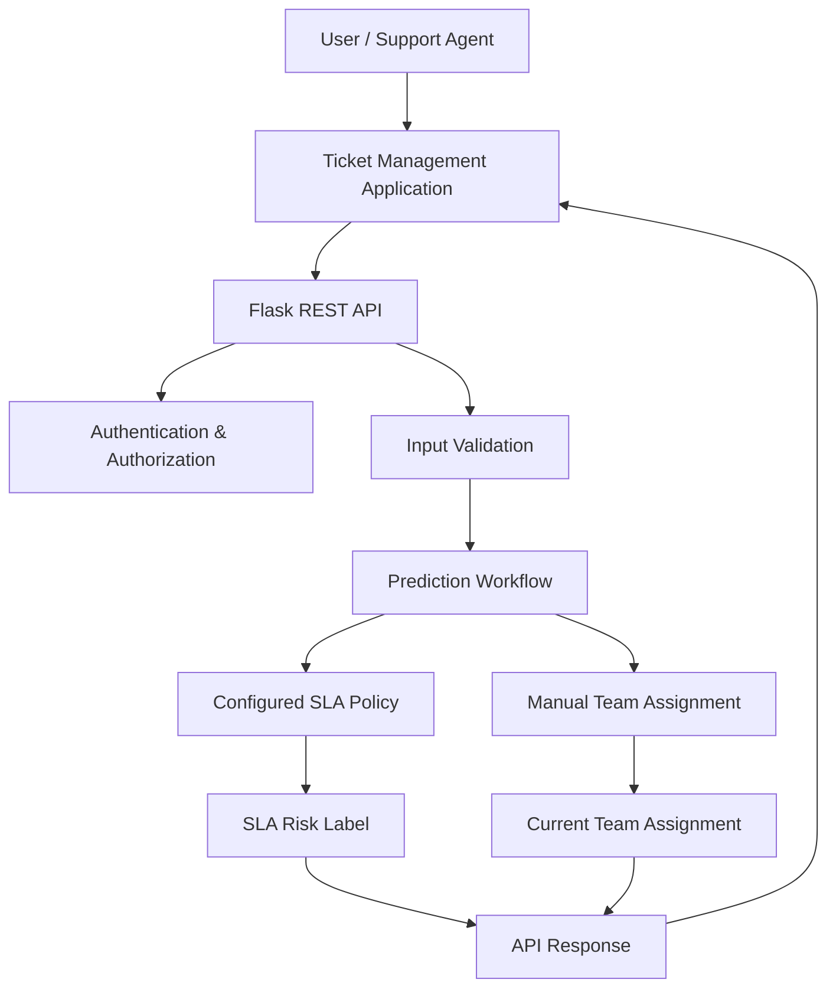
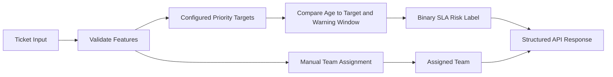

<div align="center">

# 🎫 AI-Powered Ticket Routing
### Intelligent Support Operations · SLA Risk Prediction · Flask REST API

<p>
  <a href="https://ai-powered-ticket-routing-system-1.onrender.com">
    
  </a>
  <a href="https://github.com/Ganeshbasani/AI-Powered-Ticket-Routing">
    
  </a>
</p>


<p>
  
  
  
  
  
  
</p>

<p>
  
  
  
  
</p>

**A ticket operations demo with transparent SLA risk assessment, local project help, and experimental ML candidates through a Flask API.**

[Live Demo](https://ai-powered-ticket-routing-system-1.onrender.com) · [Source Code](https://github.com/Ganeshbasani/AI-Powered-Ticket-Routing)

</div>

---

## ✨ What does it do?

Support teams handle tickets with different priorities, workloads, and response expectations. This project demonstrates ticket operations and a transparent, configurable SLA risk assessment.

The application combines a Flask REST API, a ticket-management platform, and separate experimental ML candidates to demonstrate:

- **SLA risk assessment** — compares ticket priority and elapsed age with configured targets and a warning window; the same rule drives the UI and saved assessments.
- **Team assignment** — stores a team's assignment on the ticket; automatic routing is not configured or claimed as accurate.
- **Ticket operations** — supports ticket creation, text-based team suggestions, and platform workflows.
- **Role-based access** — separates administrator, analyst, and support-agent permissions.
- **Operational visibility** — includes health/readiness endpoints and request IDs.
- **Dataset assessment** — validates input data and highlights limitations before model evaluation.

> **Important:** The default SLA targets (High 4h, Medium 8h, Low 24h) are examples, not a verified service contract. Set them to your organization's policy. The current risk result is a deterministic policy assessment, not a learned or calibrated forecast. The bundled three-row dataset and synthetic text candidates cannot establish real-world model accuracy.

Ticket creation runs the checksum-verified text candidates and stores their routing and SLA outputs with model provenance and review flags. The bundled candidates were trained on synthetic data, so the UI labels their outputs experimental and does not treat their scores as real-world performance. The ticket's assigned team remains unchanged until a person confirms it. The current three-row SLA artifact is retired and is not used for predictions. See [observed model training requirements](docs/model_training.md).

Configure the policy in `.env` using `SLA_TARGET_CRITICAL_HOURS`, `SLA_TARGET_HIGH_HOURS`, `SLA_TARGET_MEDIUM_HOURS`, `SLA_TARGET_LOW_HOURS`, and `SLA_WARNING_FRACTION_PERCENT`. Defaults are 1, 4, 8, and 24 elapsed hours, respectively; replace them with your approved policy. A ticket receives **High** policy risk when its elapsed age reaches the target or falls within the warning window; otherwise it receives **Low** policy risk. For example, a Medium ticket at 6.5 hours with the default 8-hour target has 1.5 hours remaining; the 2-hour warning window makes it **Approaching target / High risk**. The assessment uses priority and elapsed age only. Ticket text, actual outcomes, business hours, holidays, and pause rules do not affect it.

## 🚀 Live Demo

<p align="center">
  <a href="https://ai-powered-ticket-routing-system-1.onrender.com">
    
  </a>
</p>

| Demo access | Details |
|---|---|
| Application | [Open live application](https://ai-powered-ticket-routing-system-1.onrender.com) |
| Demo access | Local development only; credentials are configured in `.env`. |

The demo account was created for application review. Keep its password private and do not commit credentials, tokens, or production secrets to this repository.

**Local recruiter demo**

Set `DEMO_ADMIN_EMAIL=demo.admin@ticketroute.local` and `DEMO_ADMIN_PASSWORD` in `.env`, then run:

```bash
python -m src.cli seed-demo
python app.py
```

The development server opens the browser automatically and prints the actual URL. It starts at the configured `FLASK_PORT` (default `5000`) and selects the next available port if that port is busy; `PORT` is honored when `FLASK_PORT` is unset. Set `OPEN_BROWSER=false` to suppress automatic browser launch. The development login screen displays the configured credentials. The setup command is safe to rerun: it creates the admin only when absent and inserts only missing `DEMO-*` tickets, without changing existing ticket records or the account password. The login credential display is disabled in production. A hosted database must be seeded separately before that environment can accept the demo login.

After signing in, use the dashboard walkthrough to try predictions, accept or override decisions, analytics, mock JIRA import, user administration, and the ML lab.

### Optional local project help LLM

The **Project help** chat works without a language model by searching the bundled FAQ and project documentation. To enable interactive local LLM answers, install [Ollama](https://ollama.com/download), start it, and download a local model:

```bash
ollama pull gemma4:e2b
```

Keep these settings in `.env` (the defaults below use Ollama on this computer):

```dotenv
SUPPORT_LLM_ENABLED=true
OLLAMA_BASE_URL=http://127.0.0.1:11434
OLLAMA_MODEL=gemma4:e2b
OLLAMA_TIMEOUT_SECONDS=90
```

Restart `python app.py`. The chat status reports whether the local model is ready. Signed-in users can ask about workflows, ticket details, and aggregate analytics; the assistant includes only a few relevant ticket records and limited project documentation in each local request. Chat history stays in the browser tab. Login-screen questions use project documentation only. If Ollama is stopped or the model is missing, the docs assistant continues to answer. The integration only accepts a loopback Ollama URL, so prompts and ticket context are not sent to a hosted model.

## 🧩 Core capabilities

| Area | Capability |
|---|---|
| Prediction | SLA state and High/Low risk from configured priority targets and age |
| Routing | Ticket text creates a persisted team suggestion; a person confirms assignment |
| SLA monitoring | Timestamp-based age, policy alerts, and a 30-second dashboard refresh |
| API | Versioned Flask REST endpoints, including `/api/v1/sla/alerts` |
| Authentication | Expiring bearer-token authentication |
| Authorization | Admin, analyst, and support-agent roles |
| User management | Protected administrator endpoints |
| Readiness | Health and configured SLA-policy readiness |
| Reliability | Request IDs and structured error responses |
| Data quality | CSV, JSON, and SQLite ticket export validation |
| Risk method | Configurable priority/age SLA policy |
| ML experiments | Side-by-side synthetic TF-IDF routing/SLA candidates, marked experimental |
| Testing | Pytest test suite |
| Deployment | Docker image and GitHub Actions CI |

## 🏗️ Architecture



### Prediction workflow



## 🛠️ Technology stack

| Layer | Technologies |
|---|---|
| Programming language | Python |
| Backend | Flask |
| Experimental ML | Scikit-learn, Random Forest, TF-IDF candidates |
| Data processing | Pandas |
| Model serialization | Joblib |
| API | REST, JSON |
| Testing | Pytest |
| Containerization | Docker |
| CI | GitHub Actions |

## 🔐 Authentication and roles

The API uses expiring bearer tokens obtained through:

`POST /api/v1/auth/login`

| Role | Access |
|---|---|
| Admin | User administration and full administrative permissions |
| Analyst | Read-only ticket access |
| Support agent | Ticket creation and prediction requests |

Disabled accounts cannot log in or use existing tokens. Administrator user-management operations are protected.

For local development, bootstrap the first administrator using environment variables:

```bash
BOOTSTRAP_ADMIN_EMAIL=admin@example.com
BOOTSTRAP_ADMIN_PASSWORD=change-this-password
python -m src.cli bootstrap-admin
```

The bootstrap command refuses to overwrite an existing administrator. Never use example credentials as real deployment credentials.

## 🌐 API reference

Base URL:

```text
http://127.0.0.1:5000
```

### Health check

```http
GET /api/v1/health
```

Checks whether the application process is alive.

### Readiness check

```http
GET /api/v1/ready
```

Checks whether a valid model artifact is immediately available. Returns `503` until the application is ready.

### Login

```http
POST /api/v1/auth/login
Content-Type: application/json
```

Obtain an expiring bearer token using the configured account credentials.

### SLA prediction

```http
POST /api/v1/predict
Content-Type: application/json
Authorization: Bearer <token>
```

Request body:

```json
{
  "priority": "High",
  "created_hours": 8
}
```

The endpoint accepts exactly `priority` and `created_hours`.

The response includes the High/Low SLA risk label, SLA state, target and remaining hours, policy version, explanation, assigned team, and request ID. It does not describe the policy result as an ML prediction or probability.

> The response values depend on the running application and model artifact. Treat this JSON as an illustrative request, not a guaranteed prediction result.

### API reliability and security

- Every response includes an `X-Request-ID` header and matching `request_id` field.
- Invalid input returns a stable `validation_error` structure.
- Unexpected failures return a generic `internal_error` response.
- Request bodies are limited to 1 MB.
- Login, prediction, and mock-JIRA import have configurable single-instance rate limits.

See [Security & Operations](docs/security.md) for the detailed implementation guidance.

## 🧪 Machine-learning and data workflow

The current prediction-time inputs are:

- `priority`
- `created_hours`

The following fields are not prediction features:

- `ticket_id`
- `assigned_team`
- `sla_breach`

The project includes dataset canonicalization for CSV, JSON, and SQLite ticket exports, validation without silently dropping records, leakage-prone column warnings, and reproducible Markdown profiling.

The NLP foundation adds deterministic ticket-text preparation, leakage warnings, and a non-training TF-IDF baseline.

The authenticated **ML lab** shows whether routing and SLA candidates are trained, displays their synthetic development metrics, and provides reproducible commands. The normal ticket workflow uses the configurable priority/age SLA policy. Open a ticket and choose **Experimental text comparison** to run those candidates against its summary and description beside the configured SLA policy assessment. Candidate results are experimental, uncalibrated, and never written to baseline prediction history. Synthetic results are pipeline evidence, not production accuracy.

### Dataset limitation

The bundled dataset has only three sample tickets. It is useful for exercising experimental model pipelines, but it is **not sufficient for meaningful model evaluation or production accuracy claims**. The normal SLA workflow uses explicit configured policy rules rather than learning from this dataset.

Synthetic-development metrics, where available, must not be interpreted as production performance. Production JIRA routing and SLA mappings remain unconfigured.

Useful documentation:

- [Dataset contract](docs/dataset_contract.md)
- [Dataset profile](docs/dataset_profile.md)
- [ML data audit](docs/ml_data_audit.md)
- [NLP pipeline](docs/nlp_pipeline.md)
- [Synthetic data and candidate models](docs/synthetic_data_and_candidates.md)

## 📁 Project structure

```text
AI-Powered-Ticket-Routing/
├── api/
├── data/
│   └── tickets.csv
├── docs/
│   ├── dataset_contract.md
│   ├── dataset_profile.md
│   ├── deployment.md
│   ├── ml_data_audit.md
│   ├── nlp_pipeline.md
│   ├── platform.md
│   ├── product.md
│   └── security.md
├── ml_model/
├── src/
├── tests/
├── app.py
├── requirements.txt
├── requirements-dev.txt
└── README.md
```

## ⚙️ Run locally

### 1. Clone the repository

```bash
git clone https://github.com/Ganeshbasani/AI-Powered-Ticket-Routing.git
cd AI-Powered-Ticket-Routing
```

### 2. Create a virtual environment

**Windows**

```bash
python -m venv venv
venv\Scripts\activate
```

**Linux / macOS**

```bash
python3 -m venv venv
source venv/bin/activate
```

### 3. Install dependencies

```bash
pip install -r requirements.txt
```

For development and testing:

```bash
pip install -r requirements-dev.txt
```

### 4. Configure environment

Copy `.env.example` to `.env` and configure the required local values.

The application validates settings such as:

- `APP_ENV`
- `FLASK_PORT`
- `FLASK_DEBUG`
- `LOG_LEVEL`
- `MODEL_PATH`
- `DATA_PATH`

Model and data paths must remain inside the application directory.

### 5. Start the application

```bash
python app.py
```

Open:

```text
http://127.0.0.1:5000
```

## 🐳 Docker

Build the production container:

```bash
docker build -t sla-ticket-routing .
```

Run it:

```bash
docker run --rm -p 5000:5000 --env-file .env sla-ticket-routing
```

The Docker image uses a non-root user and writes JSON logs to stdout.

## ✅ Run tests

Compile application and test modules:

```bash
python -m compileall -q src tests
```

Run the test suite:

```bash
python -m pytest -q
```

GitHub Actions runs compilation and tests on pushes and pull requests.

## 📚 Further documentation

| Document | Description |
|---|---|
| [Product workflows](docs/product.md) | Ticket lifecycle, roles, and product workflows |
| [Platform API](docs/platform.md) | Platform endpoints and implementation |
| [Security and operations](docs/security.md) | Authentication, roles, audit, and security |
| [Deployment readiness](docs/deployment.md) | Container, CI, configuration, and artifact rollback |
| [Dataset contract](docs/dataset_contract.md) | Dataset formats and validation rules |
| [ML data audit](docs/ml_data_audit.md) | Features, target definition, and leakage review |
| [NLP pipeline](docs/nlp_pipeline.md) | Text preparation and TF-IDF baseline foundation |

## 🗺️ Roadmap

- [ ] Evaluate using a representative, timestamped ticket dataset.
- [ ] Establish meaningful model evaluation before making performance claims.
- [ ] Add a live JIRA provider only after approved credentials and network integration are available.
- [ ] Add browser-level interaction tests for the frontend.
- [ ] Introduce shared rate-limit storage for multi-instance deployments.
- [ ] Configure and validate production SLA mappings and routing integrations.

## 👨‍💻 About the developer

<div align="center">

### Basani Ganesh

**B.Tech · Computer Science & Engineering · 2026**

Interested in Python development, backend engineering, cloud technologies, DevOps, and applied machine learning.

<a href="https://github.com/Ganeshbasani">
  
</a>

</div>

## 🤝 Contributing

Suggestions, issues, and improvements are welcome. Please open an issue to discuss a proposed change before submitting a pull request.

## 📄 License

This project is licensed under the MIT License. See the [LICENSE](LICENSE) file for details.

---

<div align="center">

**If this project was useful or interesting, consider giving the repository a ⭐**

[🚀 Launch Live Demo](https://ai-powered-ticket-routing-system-1.onrender.com) · [💻 Explore Source Code](https://github.com/Ganeshbasani/AI-Powered-Ticket-Routing)

<sub>Built with Python, Flask, Scikit-learn, and a focus on transparent engineering.</sub>

</div>
