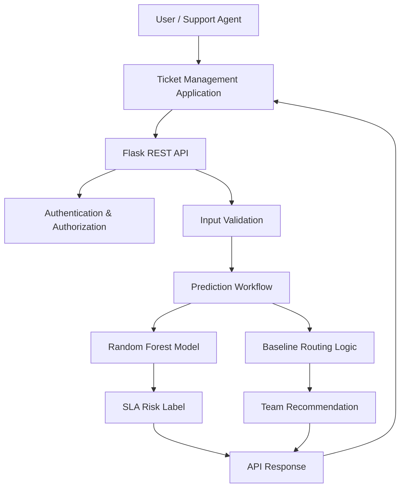
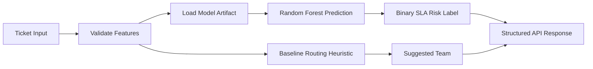

<div align="center">

# 🎫 AI-Powered Ticket Routing
### Intelligent Support Operations · SLA Risk Prediction · Flask REST API

<p>
  <a href="https://ai-powered-ticket-routing-system-1.onrender.com">
    
  </a>
  <a href="https://github.com/Ganeshbasani/AI-Powered-Ticket-Routing">
    
  </a>
</p>


<p>
  
  
  
  
  
  
</p>

<p>
  
  
  
  
</p>

**A machine-learning-assisted ticket management prototype that predicts SLA breach risk and provides a baseline team-routing recommendation through a Flask API.**

[Live Demo](https://ai-powered-ticket-routing-system-1.onrender.com) · [Source Code](https://github.com/Ganeshbasani/AI-Powered-Ticket-Routing)

</div>

---

## ✨ What does it do?

Support teams handle tickets with different priorities, workloads, and response expectations. This project explores how a machine-learning-assisted workflow can help identify tickets that may need attention.

The application combines a Flask REST API, a Random Forest classification workflow, and a ticket-management platform to demonstrate:

- **SLA risk prediction** — returns a binary risk label for a ticket.
- **Team recommendation** — provides a baseline routing recommendation.
- **Ticket operations** — supports ticket creation and platform workflows.
- **Role-based access** — separates administrator, analyst, and support-agent permissions.
- **Operational visibility** — includes health/readiness endpoints and request IDs.
- **Dataset assessment** — validates input data and highlights limitations before model evaluation.

> **Important:** This is a prototype, not a production-validated SLA prediction system. The bundled dataset contains only three sample records and is insufficient to establish model accuracy or real-world performance.

## 🚀 Live Demo

<p align="center">
  <a href="https://ai-powered-ticket-routing-system-1.onrender.com">
    
  </a>
</p>

| Demo access | Details |
|---|---|
| Application | [Open live application](https://ai-powered-ticket-routing-system-1.onrender.com) |
| Demo email | `recruiter.demo@ticketrouting.app` |
| Account role | `admin` |
| Password | Use the demo password configured for this account. It is not published in this README. |

The demo account was created for application review. Keep its password private and do not commit credentials, tokens, or production secrets to this repository.

**Suggested demo walkthrough**
1. Open the live application.
2. Sign in using the demo account credentials supplied by the project maintainer.
3. Explore the ticket workflow and available dashboard features.
4. Create a sample ticket and inspect the available prediction/routing workflow.
5. Review the API and documentation sections below.

## 🧩 Core capabilities

| Area | Capability |
|---|---|
| Prediction | Binary SLA breach-risk label |
| Routing | Baseline team recommendation |
| API | Versioned Flask REST endpoints |
| Authentication | Expiring bearer-token authentication |
| Authorization | Admin, analyst, and support-agent roles |
| User management | Protected administrator endpoints |
| Readiness | Health and model-readiness checks |
| Reliability | Request IDs and structured error responses |
| Data quality | CSV, JSON, and SQLite ticket export validation |
| ML foundation | Deterministic text preparation and TF-IDF baseline foundation |
| Testing | Pytest test suite |
| Deployment | Docker image and GitHub Actions CI |

## 🏗️ Architecture



### Prediction workflow



## 🛠️ Technology stack

| Layer | Technologies |
|---|---|
| Programming language | Python |
| Backend | Flask |
| Machine learning | Scikit-learn, Random Forest |
| Data processing | Pandas |
| Model serialization | Joblib |
| API | REST, JSON |
| Testing | Pytest |
| Containerization | Docker |
| CI | GitHub Actions |

## 🔐 Authentication and roles

The API uses expiring bearer tokens obtained through:

`POST /api/v1/auth/login`

| Role | Access |
|---|---|
| Admin | User administration and full administrative permissions |
| Analyst | Read-only ticket access |
| Support agent | Ticket creation and prediction requests |

Disabled accounts cannot log in or use existing tokens. Administrator user-management operations are protected.

For local development, bootstrap the first administrator using environment variables:

```bash
BOOTSTRAP_ADMIN_EMAIL=admin@example.com
BOOTSTRAP_ADMIN_PASSWORD=change-this-password
python -m src.cli bootstrap-admin
```

The bootstrap command refuses to overwrite an existing administrator. Never use example credentials as real deployment credentials.

## 🌐 API reference

Base URL:

```text
http://127.0.0.1:5000
```

### Health check

```http
GET /api/v1/health
```

Checks whether the application process is alive.

### Readiness check

```http
GET /api/v1/ready
```

Checks whether a valid model artifact is immediately available. Returns `503` until the application is ready.

### Login

```http
POST /api/v1/auth/login
Content-Type: application/json
```

Obtain an expiring bearer token using the configured account credentials.

### SLA prediction

```http
POST /api/v1/predict
Content-Type: application/json
Authorization: Bearer <token>
```

Request body:

```json
{
  "priority": "High",
  "created_hours": 8
}
```

The endpoint accepts exactly `priority` and `created_hours`.

The response includes the binary SLA risk label, the existing routing heuristic result, model version, and request ID. It does not expose an uncalibrated model probability.

> The response values depend on the running application and model artifact. Treat this JSON as an illustrative request, not a guaranteed prediction result.

### API reliability and security

- Every response includes an `X-Request-ID` header and matching `request_id` field.
- Invalid input returns a stable `validation_error` structure.
- Unexpected failures return a generic `internal_error` response.
- Request bodies are limited to 1 MB.
- Login, prediction, and mock-JIRA import have configurable single-instance rate limits.

See [Security & Operations](docs/security.md) for the detailed implementation guidance.

## 🧪 Machine-learning and data workflow

The current prediction-time inputs are:

- `priority`
- `created_hours`

The following fields are not prediction features:

- `ticket_id`
- `assigned_team`
- `sla_breach`

The project includes dataset canonicalization for CSV, JSON, and SQLite ticket exports, validation without silently dropping records, leakage-prone column warnings, and reproducible Markdown profiling.

The NLP foundation adds deterministic ticket-text preparation, leakage warnings, and a non-training TF-IDF baseline.

### Dataset limitation

The bundled dataset has only three sample tickets. It is useful for exercising the pipeline, but it is **not sufficient for meaningful model evaluation, production accuracy claims, or reliable real-world SLA conclusions**.

Synthetic-development metrics, where available, must not be interpreted as production performance. Production JIRA routing and SLA mappings remain unconfigured.

Useful documentation:

- [Dataset contract](docs/dataset_contract.md)
- [Dataset profile](docs/dataset_profile.md)
- [ML data audit](docs/ml_data_audit.md)
- [NLP pipeline](docs/nlp_pipeline.md)
- [Synthetic data and candidate models](docs/synthetic_data_and_candidates.md)

## 📁 Project structure

```text
AI-Powered-Ticket-Routing/
├── api/
├── data/
│   └── tickets.csv
├── docs/
│   ├── dataset_contract.md
│   ├── dataset_profile.md
│   ├── deployment.md
│   ├── ml_data_audit.md
│   ├── nlp_pipeline.md
│   ├── platform.md
│   ├── product.md
│   └── security.md
├── ml_model/
├── src/
├── tests/
├── app.py
├── requirements.txt
├── requirements-dev.txt
└── README.md
```

## ⚙️ Run locally

### 1. Clone the repository

```bash
git clone https://github.com/Ganeshbasani/AI-Powered-Ticket-Routing.git
cd AI-Powered-Ticket-Routing
```

### 2. Create a virtual environment

**Windows**

```bash
python -m venv venv
venv\Scripts\activate
```

**Linux / macOS**

```bash
python3 -m venv venv
source venv/bin/activate
```

### 3. Install dependencies

```bash
pip install -r requirements.txt
```

For development and testing:

```bash
pip install -r requirements-dev.txt
```

### 4. Configure environment

Copy `.env.example` to `.env` and configure the required local values.

The application validates settings such as:

- `APP_ENV`
- `FLASK_PORT`
- `FLASK_DEBUG`
- `LOG_LEVEL`
- `MODEL_PATH`
- `DATA_PATH`

Model and data paths must remain inside the application directory.

### 5. Start the application

```bash
python app.py
```

Open:

```text
http://127.0.0.1:5000
```

## 🐳 Docker

Build the production container:

```bash
docker build -t sla-ticket-routing .
```

Run it:

```bash
docker run --rm -p 5000:5000 --env-file .env sla-ticket-routing
```

The Docker image uses a non-root user and writes JSON logs to stdout.

## ✅ Run tests

Compile application and test modules:

```bash
python -m compileall -q src tests
```

Run the test suite:

```bash
python -m pytest -q
```

GitHub Actions runs compilation and tests on pushes and pull requests.

## 📚 Further documentation

| Document | Description |
|---|---|
| [Product workflows](docs/product.md) | Ticket lifecycle, roles, and product workflows |
| [Platform API](docs/platform.md) | Platform endpoints and implementation |
| [Security and operations](docs/security.md) | Authentication, roles, audit, and security |
| [Deployment readiness](docs/deployment.md) | Container, CI, configuration, and artifact rollback |
| [Dataset contract](docs/dataset_contract.md) | Dataset formats and validation rules |
| [ML data audit](docs/ml_data_audit.md) | Features, target definition, and leakage review |
| [NLP pipeline](docs/nlp_pipeline.md) | Text preparation and TF-IDF baseline foundation |

## 🗺️ Roadmap

- [ ] Evaluate using a representative, timestamped ticket dataset.
- [ ] Establish meaningful model evaluation before making performance claims.
- [ ] Add a live JIRA provider only after approved credentials and network integration are available.
- [ ] Add browser-level interaction tests for the frontend.
- [ ] Introduce shared rate-limit storage for multi-instance deployments.
- [ ] Configure and validate production SLA mappings and routing integrations.

## 👨‍💻 About the developer

<div align="center">

### Basani Ganesh

**B.Tech · Computer Science & Engineering · 2026**

Interested in Python development, backend engineering, cloud technologies, DevOps, and applied machine learning.

<a href="https://github.com/Ganeshbasani">
  
</a>

</div>

## 🤝 Contributing

Suggestions, issues, and improvements are welcome. Please open an issue to discuss a proposed change before submitting a pull request.

## 📄 License

This project is licensed under the MIT License. See the [LICENSE](LICENSE) file for details.

---

<div align="center">

**If this project was useful or interesting, consider giving the repository a ⭐**

[🚀 Launch Live Demo](https://ai-powered-ticket-routing-system-1.onrender.com) · [💻 Explore Source Code](https://github.com/Ganeshbasani/AI-Powered-Ticket-Routing)

<sub>Built with Python, Flask, Scikit-learn, and a focus on transparent engineering.</sub>

</div>
